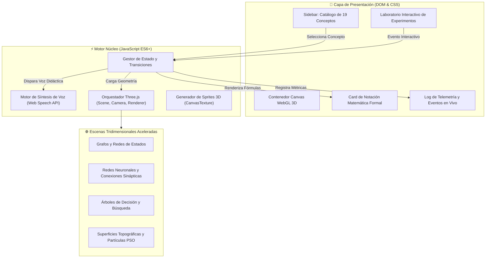

# 🌐 SIMULADOR INTERACTIVO 3D DE INTELIGENCIA ARTIFICIAL (IA)
### *Plataforma Educativa Inmersiva con WebGL, Three.js y Narración Sincronizada en Tiempo Real*

<div align="center">


-green?style=for-the-badge&logo=soundcharts)


**Autor:** Ing. Juancito Peña | **Edición:** Master Architect Pro 2026

[🚀 Explorar Módulos](#-catálogo-de-los-19-módulos-interactivos) • [🕹️ Cómo Ejecutar](#️-guía-rápida-de-ejecución) • [🧠 Arquitectura Técnica](#-arquitectura-técnica) • [📋 Estado del Proyecto](file:///STATUS_PROYECTO.md)

</div>

---

## 🌟 Descripción General

El **Simulador Interactivo 3D de Inteligencia Artificial** es un entorno virtual web de alta fidelidad diseñado para la enseñanza interactiva y conceptualización profunda de los 19 fundamentos matemáticos, algorítmicos y paradigmáticos de la Inteligencia Artificial.

A través de modelos tridimensionales interactivos acelerados por GPU (**Three.js / WebGL**), el usuario experimenta en tiempo real con agentes de búsqueda, redes de neuronas, árboles de decisión, algoritmos genéticos, lógica difusa, metaheurísticas y grafos de conocimiento, todo acompañado por un motor de **narración por voz en español sincronizada paso a paso**, fórmulas matemáticas formales y un log de telemetría de eventos en vivo.

---

## ✨ Características Destacadas

- 🎮 **Visualización 3D Interactiva en Tiempo Real**: Renderizado con `Three.js` (r128), sombras volumétricas, etiquetas dinámicas sobre sprites 2D en espacio tridimensional (`CanvasTexture`) y control orbital completo de cámara (`OrbitControls`: rotación, zoom y paneo).
- 🎙️ **Narración Sincronizada por Voz (Web Speech API)**: Sistema autónomo de síntesis de voz en español que explica didácticamente cada concepto, fórmula y acción simulada en el espacio 3D.
- 📐 **Rigor Matemático y Fórmulas en Pantalla**: Notación matemática formal y desglosada paso a paso para cada algoritmo (funciones de costo, heurísticas, grafos, probabilidades bayesianas, pertenencia difusa).
- 🧪 **Laboratorio de Experimentación Activa**: Botones de acción interactiva en cada módulo que permiten alterar el estado del sistema, inducir fallos, mutar genes, aplicar operadores de inferencia y observar la respuesta del algoritmo.
- ⚡ **Control de Simulación de Precisión**: Selector de velocidad (0.5x, 1.0x, 2.0x), selector de voz, barra de progreso secuencial y consola de eventos en tiempo real.
- 📱 **Diseño Responsivo de Alto Contraste**: Interfaz optimizada con **Bootstrap 5.3.2**, tipografía legible (*Inter* y *JetBrains Mono*) y panel lateral retráctil para maximizar el área del canvas 3D.
- 📦 **Cero Fricción de Despliegue**: Aplicación monolitica autosuficiente en un único archivo ejecutable en cualquier navegador moderno sin requerir NodeJS, empaquetadores ni compilación previa.

---

## 📚 Catálogo de los 19 Módulos Interactivos

| # | Módulo / Concepto | Paradigma / Algoritmo | Visualización 3D | Experimento Interactivo |
|---|-------------------|------------------------|------------------|-------------------------|
| **01** | **Definición y Formulación de Problemas** | Tupla formal $(S_0, Actions, Result, GoalTest, PathCost)$ | Laberinto con cuadrícula, obstáculos y agente esférico | Paso a paso del modelo de transición |
| **02** | **Espacios de Estados y Modelado Matemático** | Grafos de estados ponderados con matriz de adyacencia | Red topológica de ciudades interconectadas por aristas cilíndricas | Selección y cálculo de ruta alternativa de costo mínimo |
| **03** | **Estrategias de Búsqueda** | Deterministas, Heurísticas y Algoritmos Genéticos | Población cromosómica en espacio tridimensional | Evaluación de mutación y cruce cromosómico |
| **04** | **Búsqueda a Ciegas (No Informada)** | Amplitud (BFS) vs. Profundidad (DFS) | Árbol jerárquico tridimensional con niveles de profundidad | Expansión FIFO por capas vs. LIFO recursivo |
| **05** | **Búsqueda Heurística** | Ascensión a la Cima (Hill Climbing) y Algoritmo A* ($f=g+h$) | Superficie con gradiente topográfico y baldosas de costo | Ejecución de A* eludiendo óptimos locales |
| **06** | **Satisfacción de Restricciones (CSP)** | Consistencia de arcos (AC-3), Backtracking y poda de dominios | Nodos con restricciones de adyacencia cromática | Propagación de restricciones y resolución de colisión de color |
| **07** | **Búsqueda con Adversarios** | Minimax y Poda Alfa-Beta en árboles de juego | Árbol de decisiones con nodos MAX (verdes) y MIN (rojos) | Poda de ramas irrelevantes ahorrando cómputo |
| **08** | **Búsqueda en Entornos Dinámicos** | Planificación incremental $D^*$ Lite y evasión reactiva LIDAR | Calzada tridimensional con vehículo autónomo | Caída imprevista de obstáculo y replanificación en 12 ms |
| **09** | **Metaheurísticas y Optimización Estocástica** | Optimización por Enjambre de Partículas (PSO) y Recocido Simulado | Partículas 3D convergiendo hacia el valle óptimo global | Dispersión estocástica y convergencia hacia el mínimo |
| **10** | **Bases de Conocimiento (KB)** | Lógica declarativa, operaciones formales `TELL` y `ASK` | Repositorio cúbico de hechos y reglas conectadas | Inyección de axiomas y consulta deductiva en tiempo real |
| **11** | **Modelos de Representación** | Simbólicos, Conexionistas e Híbridos (Neuro-Simbólicos) | Red Neuronal multicapa (esferas) puenteada a árbol lógico | Detección de patrones visuales y validación de regla médica |
| **12** | **Lógica Clásica e Inferencia** | Proposicional / Primer Orden, Modus Ponens y Resolución | Premisas encadenadas por operadores de implicación | Demostración formal y resolución por contradicción |
| **13** | **Reglas de Producción y Sistemas Expertos** | Motores de reglas Rete, Forward Chaining y Backward Chaining | Red de reglas `SI... ENTONCES` activándose secuencialmente | Encadenamiento hacia adelante ante nuevos síntomas |
| **14** | **Marcos Conceptuales (Frames)** | Estructuras de Minsky con atributos, facetas y herencia | Jerarquía de cajas estructuradas con ranuras (slots) | Herencia de propiedades y sobreescritura de valores por defecto |
| **15** | **Redes Semánticas y Grafos de Conocimiento** | Ontologías semánticas con aristas `es_un`, `parte_de` y `posee` | Grafo tridimensional de entidades y relaciones ontológicas | Inferencia transitiva cruzando múltiples relaciones |
| **16** | **Lógica de la Incertidumbre** | Teorema de Bayes, Probabilidad Condicional y Factores de Certeza | Balanza de probabilidades y distribución de densidad | Actualización de creencia a priori tras evidencia médica |
| **17** | **Redes Bayesianas** | Modelos Gráficos Probabilísticos y Propagación de Creencias | Grafo Acíclico Dirigido (DAG) con tablas CPT en cada nodo | Inyección de evidencia y actualización de probabilidades marginales |
| **18** | **Lógica Borrosa (Fuzzy Logic)** | Conjuntos difusos, funciones de membresía y defuzzificación | Curvas trapezoidales/triangulares en plano tridimensional | Fuzzificación de variable continua y cálculo del centroide |
| **19** | **Ontologías y Web Semántica** | Especificaciones OWL, tripletas RDF y razonadores de descripción | Red ontológica de clases, individuos y propiedades formales | Razonamiento semántico descubriendo clasificaciones implícitas |

---

## 🕹️ Guía Rápida de Ejecución

### Opción 1: Apertura Directa en el Navegador (Sin instalación)
Simplemente haz doble clic sobre el archivo `index.html` o ábrelo desde cualquier navegador moderno (Google Chrome, Microsoft Edge, Mozilla Firefox, Brave, Safari, Opera).

```bash
# En Windows (PowerShell)
Start-Process "index.html"
```

### Opción 2: Servidor Local de Desarrollo
Si prefieres servirlo mediante un servidor HTTP local:

```bash
# Utilizando Python 3
python -m http.server 8080

# O utilizando Node.js (npx)
npx serve .
```
Abre en tu navegador: `http://localhost:8080`

---

## 🧠 Arquitectura Técnica



### Tecnologías Empleadas
- **Three.js (v0.128.0)**: Renderizador WebGL, luces ambientales y direccionales, geometrías primitivas y procedurales (`BoxGeometry`, `SphereGeometry`, `CylinderGeometry`, `BufferGeometry`).
- **OrbitControls**: Navegación intuitiva mediante ratón (rotación con click izquierdo, paneo con click derecho, zoom con rueda).
- **Web Speech API**: Síntesis de voz nativa multicanal en tiempo real con cancelación de colisiones de audio y cola prioritaria.
- **Bootstrap 5.3.2**: Grid responsivo, cards con sombras sutiles, botones temáticos e insignias de estado.
- **FontAwesome 6.4.2**: Iconografía técnica y de control multimedia.
- **Google Fonts**: Tipografías de alto estándar técnico (*Inter* y *JetBrains Mono*).

---

## 📂 Estructura del Repositorio

```text
Simulador-Interactivo-3D-Inteligencia-Artificial/
│
├── index.html            # Aplicación web completa y autosuficiente (Three.js + UI + Audio)
├── README.md             # Documentación exhaustiva y presentación del proyecto
├── STATUS_PROYECTO.md    # Bitácora maestra, estado de validación y roadmap técnico
└── .gitignore            # Configuración de exclusiones de Git
```

---

## 👨‍💻 Autor y Créditos

- **Desarrollador y Arquitecto:** Ing. Juancito Peña
- **Perfil Profesional:** Arquitecto de Software, Datos y Soluciones de Inteligencia Artificial.
- **Especialidad:** Aplicaciones Full-Stack, Modelado Tabular, Dashboards de Alto Nivel y Simuladores Interactivos.

---

## 📄 Licencia

Este proyecto se distribuye bajo la Licencia **MIT**. Consulta el código fuente para más detalles sobre su libre distribución, modificación y uso pedagógico o profesional.
